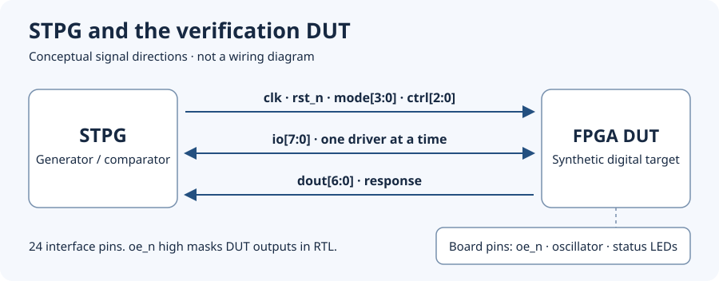

# STPG_RP2350_VERIFY_FPGA

Optional reference HDL for verifying an STPG pattern generator against a
synthetic digital DUT. The [STPG core and GUI](https://github.com/okamitsu320/STPG_RP2350)
do not require an FPGA.

This repository contains one verification RTL with a 24-pin
STPG interface plus board output-enable, oscillator and LED ports, the Cyclone
10 LP Quartus project, self-checking host simulations and this manual.
Original code is [MIT](LICENSE).



The diagram shows signal groups, not physical wiring or validated timing. See the
[interface and board checklist](manual/interface.md) before connecting a board.

## Host-only simulation

Install Icarus Verilog (iverilog and vvp) and Python 3.10 or newer, then run:

```sh
python -m unittest discover -s tests -v
```

The tests compile only the supplied HDL into a temporary directory and simulate
public synthetic stimuli. They do not use a cable, programmer, USB or JTAG.
All three benches compile the same `rtl/pattern_verify_dut_24pin_vf.v` that
the Quartus project selects. They include the full 48-entry address range,
mode 2's free-running counter, mode 3's LFSR, delay modes 0–3, bus handoff
and the board's output-enable/reset logic. The board RTL bytes are unchanged;
the obsolete second module variant is no longer included.
Pass means these selected RTL behaviours were simulated, not that hardware
wiring or timing is validated.

## Status

The owner used a third-party Cyclone 10 LP board labelled 10CL006YE144C8G.
The [board-specific Quartus project](boards/cyclone10lp/README.md) now includes
its QPF/QSF/SDC and selects the same single RTL as the simulations.
No programming image is included, and no Quartus build
or electrical qualification of this exported project is claimed.
Do not reuse pin assignments from another board. See
[the interface and board checklist](manual/interface.md).

Board-specific synthesis, verification of the supplied pin/timing constraints,
programming and physical verification of this project are pending. No physical
operation is authorized by this repository or test command.
